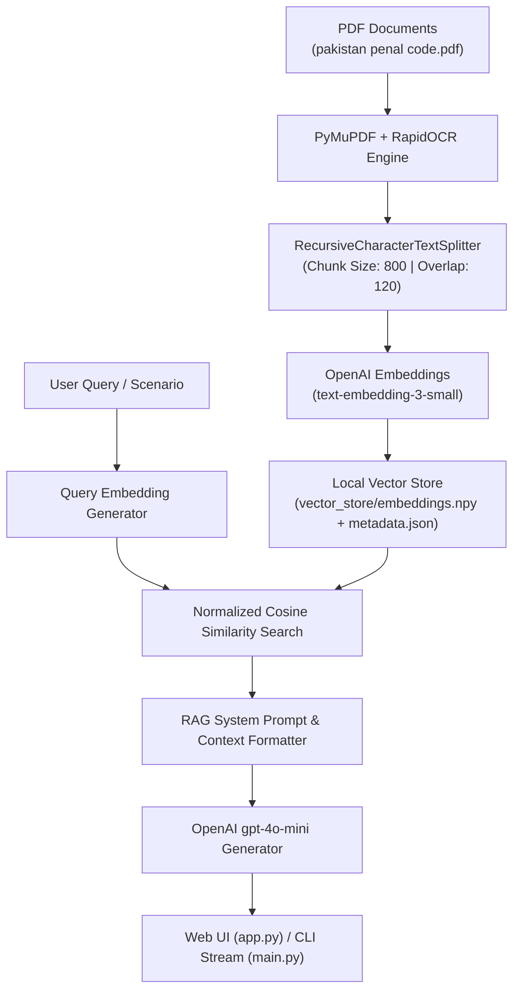

# ⚖️ Pakistan Penal Code (PPC 1860) AI Legal RAG Chatbot


An intelligent **Retrieval-Augmented Generation (RAG)** legal assistant trained on **The Pakistan Penal Code (PPC 1860)** and Criminal Law materials. 

The chatbot acts as a specialized **Applicable Sections Advisor** and **Citizens' Legal Rights Advisor**, providing precise legal section citations, punishment breakdowns, private defense guidance, and actionable legal steps.

---

## 🌟 Key Features

- ⚖️ **Applicable PPC Sections Advisor:** Describe any crime or incident (e.g., theft, housebreaking, fraud, extortion, criminal intimidation), and the system automatically identifies applicable PPC sections (e.g. PPC 380, 457, 506), punishment ranges, and legal status (Bailable/Non-bailable, Cognizable/Non-cognizable).
- 🛡️ **Citizens' Legal Rights Advisor:** Guides users on their **Right of Private Defense (PPC Sections 96–106)** to protect body and property, procedure for lodging an FIR (Sec 154 CrPC), and next legal steps.
- 🔍 **Hybrid PDF/OCR Parsing:** Combines direct text extraction via **PyMuPDF (`fitz`)** with **`rapidocr-onnxruntime`** fallback to handle scanned book pages seamlessly.
- 📖 **Exact Source Citations:** Every legal response includes precise document page numbers (e.g. `[pakistan penal code.pdf - Page 80]`).
- 🖥️ **Dual User Interface:**
  - **Modern Web UI (`app.py`):** Dark glassmorphic interface with `marked.js` markdown rendering, section styling, and source pills.
  - **Terminal CLI (`main.py`):** Command-line chat featuring real-time token streaming (`stream=True`).

---

## 🏗️ System Architecture



---

## 📁 Repository Structure

```text
├── pakistan penal code.pdf   # Primary legal text (PPC 1860)
├── indexer.py               # PDF parser, OCR engine, and vector embedder
├── vector_store.py          # Local vector index & cosine similarity search engine
├── rag_chain.py             # RAG pipeline, system prompts, and LLM completions
├── main.py                  # Terminal CLI interactive chat interface
├── app.py                   # Flask Web UI server (http://127.0.0.1:5000)
├── vector_store/            # Persisted local embeddings (.npy & metadata.json)
├── requirements.txt         # Project dependencies
└── README.md                # Project documentation
```

---

## 🚀 Getting Started

### 1. Prerequisites
- Python 3.10 or higher installed.
- An OpenAI API Key (`OPENAI_API_KEY`).

### 2. Installation & Setup

1. **Clone the repository:**
   ```bash
   git clone https://github.com/your-username/ppc-rag-chatbot.git
   cd ppc-rag-chatbot
   ```

2. **Create virtual environment & install dependencies:**
   ```bash
   python -m venv venv
   # Windows:
   venv\Scripts\activate
   # Linux/macOS:
   source venv/bin/activate

   pip install -r requirements.txt
   ```

3. **Configure Environment Variables:**
   Create a `.env` file in the root directory:
   ```env
   OPENAI_API_KEY=your_openai_api_key_here
   ```

---

## 💻 Running the Application

### Option 1: Modern Web Chat UI (Recommended)
Run the Flask Web server:
```bash
python app.py
```
Open your browser and navigate to:  
👉 **[http://127.0.0.1:5000](http://127.0.0.1:5000)**

### Option 2: Terminal CLI Chat
Run the command-line interface:
```bash
python main.py
```

*Note: On first run, the system will automatically index `pakistan penal code.pdf` and save the local vector store.*

---

## 🧪 Example Query & Response

**User Scenario:**  
> *"Someone broke into my house at night and stole money while threatening my family. Which PPC sections apply and what are my legal rights?"*

**Assistant Response:**
- **PPC Section 457:** Lurking House-Trespass or House-Breaking by Night *(Imprisonment up to 14 years + fine | Non-bailable)* `[pakistan penal code.pdf - Page 104]`
- **PPC Section 380:** Theft in Dwelling House *(Imprisonment up to 7 years + fine)* `[pakistan penal code.pdf - Page 92]`
- **PPC Section 506:** Criminal Intimidation *(Imprisonment up to 7 years)* `[pakistan penal code.pdf - Page 116]`
- **Legal Rights:** Right of Private Defense of Body & Property (PPC Sec 96, 97, 103) + Right to lodge an FIR under Sec 154 CrPC.

---

## 🛡️ Legal Disclaimer
*This project is built for educational, research, and informational purposes based on the Pakistan Penal Code (PPC 1860). It does not constitute formal legal advice. For active litigation or legal matters, consult a licensed advocate.*

---

## 📝 License
Distributed under the MIT License. See `LICENSE` for more information.
