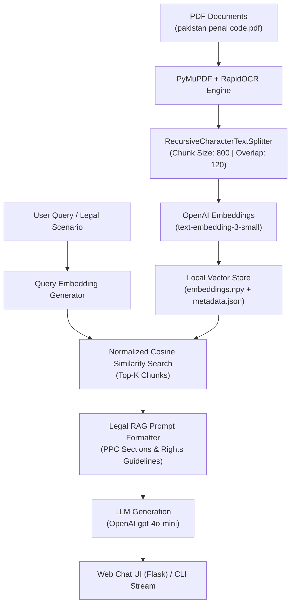

# 🚀 Building an AI-Powered Legal RAG Chatbot for the Pakistan Penal Code (PPC 1860)

Here is a ready-to-share **LinkedIn Post** and **Technical Case Study** detailing how this Retrieval-Augmented Generation (RAG) system was designed and built from scratch!

---

## 📱 LinkedIn Post Draft (Copy & Paste Ready)

```text
🚀 Excited to share my latest AI project: An AI-Powered Legal Assistant & RAG System trained on the Pakistan Penal Code (PPC 1860)! ⚖️🇵🇰

Navigating complex legal frameworks, finding relevant penal sections, and understanding citizen rights can be challenging. To solve this, I built an end-to-end Retrieval-Augmented Generation (RAG) chatbot using Python, OpenAI embeddings, PyMuPDF, and Flask!

💡 Key Features:
1️⃣ Applicable Sections Advisor: Describe any crime scenario (e.g. theft, housebreaking, fraud, extortion), and the AI instantly identifies applicable PPC Sections (e.g. PPC 380, 457, 506) along with prescribed punishments and legal status (Bailable/Non-bailable).
2️⃣ Citizens' Legal Rights Advisor: Guides users on their Right of Private Defense (PPC Sections 96–106), procedure for lodging an FIR (Sec 154 CrPC), and actionable legal steps.
3️⃣ Hybrid Document Engine: Combines direct PDF text extraction with RapidOCR fallback to handle scanned legal books seamlessly.
4️⃣ Precise Source Citations: Every legal answer includes exact document page citations (e.g., [pakistan penal code.pdf - Page 80]).
5️⃣ Dual Interface: Sleek Glassmorphic Web UI (Flask + Marked.js) and real-time streaming Terminal CLI chat!

🧠 Tech Stack: Python | OpenAI API (text-embedding-3-small & gpt-4o-mini) | PyMuPDF | RapidOCR | NumPy Vector Search | Flask

Check out the full technical architecture below! 👇

#ArtificialIntelligence #GenerativeAI #RAG #Python #OpenAI #LegalTech #MachineLearning #WebDevelopment #PakistanPenalCode #NLP #AIProduct
```

---

## 🛠️ Technical Case Study: How We Built the System



---

### Step 1: Hybrid Document Parsing & OCR Pipeline (indexer.py)
- **Challenge:** Legal books often contain a mix of digital text and scanned page images.
- **Solution:** Implemented a hybrid parser using **PyMuPDF (`fitz`)** for digital text and **`rapidocr-onnxruntime`** as an automatic fallback for scanned pages.
- **Chunking Strategy:** Used `RecursiveCharacterTextSplitter` with a chunk size of 800 characters and 120-character overlap to preserve full legal section contexts and preserve exact page numbers.

### Step 2: Vector Embedding & Local Persistence (vector_store.py)
- **Embeddings:** Converted 800+ text chunks into 1536-dimensional dense vector embeddings via OpenAI's `text-embedding-3-small`.
- **Fast Local Storage:** Saved normalized vector matrices in `vector_store/embeddings.npy` and chunk metadata in `vector_store/metadata.json`.
- **Search Engine:** Built a zero-external-database cosine similarity search engine using `numpy.dot()` for sub-millisecond retrieval speeds.

### Step 3: Dual Legal RAG Prompt Engineering (rag_chain.py)
Designed a system prompt for legal analysis:
1. **Applicable Sections Advisor:** Analyzes factual scenarios to determine applicable PPC sections, punishment ranges, and bail status.
2. **Legal Rights Advisor:** Explains private defense rights (PPC 96–106), FIR filing rights, and next steps.
3. **Responsible AI Rules:** Prevents speculative assumptions based on personal names (e.g. "Sheraz Ahmad") and enforces strict fact-grounded responses.

### Step 4: Full-Stack Web App & Streaming Interface (app.py & main.py)
- **Web UI:** Developed a responsive Flask web application featuring a dark glassmorphic design, `marked.js` markdown rendering, and interactive page citation pills.
- **CLI Chat:** Created a command-line interface featuring real-time token streaming (`stream=True`).

---

## 🎯 Sample System Output

> **User Query:** *"Someone broke into my house at night and stole money while threatening my family. Which PPC sections apply and what are my legal rights?"*
> 
> **AI Legal Response:**
> - **PPC Section 457:** Lurking House-Trespass or House-Breaking by Night *(Imprisonment up to 14 years + fine | Non-bailable)* `[pakistan penal code.pdf - Page 104]`
> - **PPC Section 380:** Theft in Dwelling House *(Imprisonment up to 7 years + fine)* `[pakistan penal code.pdf - Page 92]`
> - **PPC Section 506:** Criminal Intimidation *(Imprisonment up to 7 years)* `[pakistan penal code.pdf - Page 116]`
> - **Legal Rights:** Private Defense of Body & Property (PPC Sec 96, 97, 103) + Right to lodge an FIR under Sec 154 CrPC.
